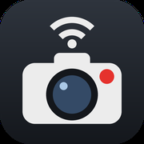
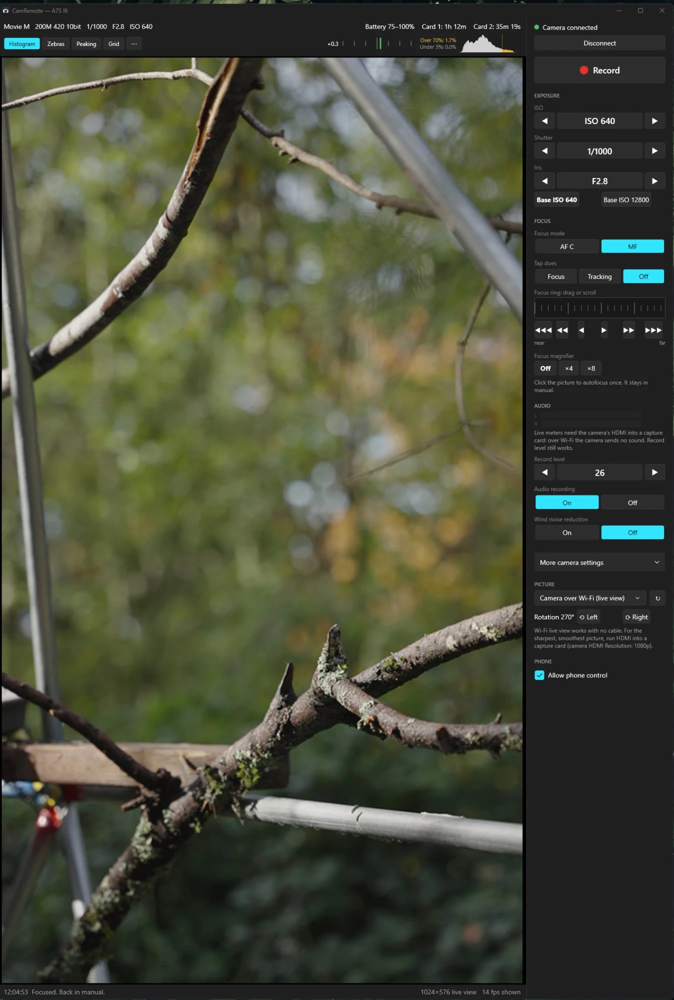
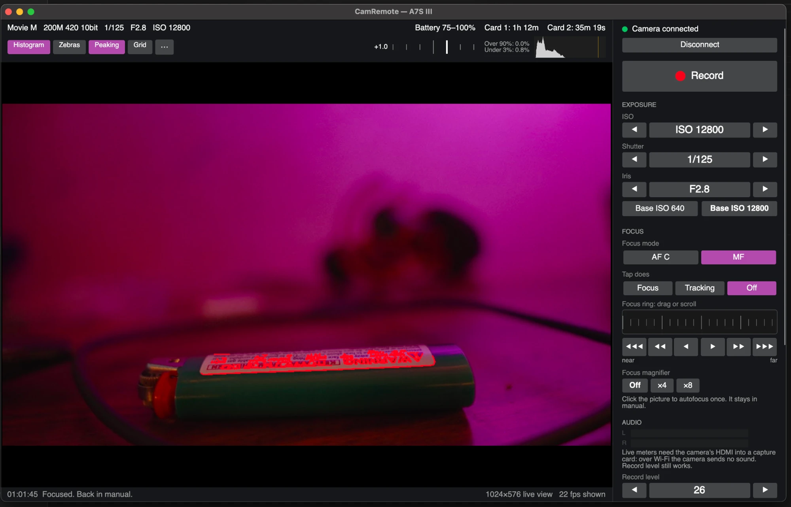

<div align="center">



# CamRemote

**Control your Sony camera from your computer or phone.**<br>
See the live picture, focus, set exposure and hit record, with no cables and from anywhere your Wi-Fi reaches.

<br>

<a href="https://github.com/RemingtonWilcox/CamRemote/releases/latest/download/CamRemote-Windows-Setup.exe"></a>
&nbsp;
<a href="https://github.com/RemingtonWilcox/CamRemote/releases/latest/download/CamRemote-Mac-AppleSilicon.dmg"></a>

<sub>Free. No account needed. <a href="https://github.com/RemingtonWilcox/CamRemote/releases/latest/download/CamRemote-Mac-Intel.dmg">Older Intel Mac? Use this one.</a></sub>

<br><br>



</div>

<br>

## Which cameras work?

CamRemote is tested on the **A7S III**. Sony says its remote software can control these cameras over Wi-Fi, so they should work too, but nobody has tried them yet.

| | |
|---|---|
| **Alpha full frame** | A1 II · A1 · A9 III · A7R VI · A7R V · A7CR · **A7S III ✅** · A7 V · A7 IV · A7C II |
| **Alpha APS-C** | a6700 |
| **Cinema Line** | FX6 (firmware 3.00 or later) · FX3 (firmware 2.00 or later) · FX3A · FX2 · FX30 · BURANO |
| **Vlogging** | ZV-E1 · ZV-E10 II |
| **Camcorders** | PXW-Z300 · PXW-Z200 · HXR-NX800 |
| **Other** | RX1R III · ILX-LR1 |

✅ = tested. Update your camera to its latest firmware first. Some features, such as click to focus, may behave differently on your camera.

**Won't work over Wi-Fi:** A9 II, A7R IV, A7R IVA, A7C, RX0 II, BRC-AM7 and FR7. Cameras not listed at all, such as the A7 III or a6400, aren't supported by Sony's software.

<br>

## Set it up in 3 steps

Allow about 10 minutes. You only do this once.

| | | |
|---|---|---|
| **1** | **[Install the app](#1-install-the-app)** | 2 minutes |
| **2** | **[Set up your camera](#2-set-up-your-camera)** | 5 minutes |
| **3** | **[Connect](#3-connect)** | 1 minute |

> [!TIP]
> **Have an AI assistant?** It can walk you through all of this. [Here's what to paste](#let-your-ai-do-it).

**You'll need:** [a supported camera](#which-cameras-work), Wi-Fi at the place you're shooting, and a Windows 11 PC or a Mac on macOS 14.1 or newer.

<br>

## 1. Install the app

<details open>
<summary><b>On Windows</b></summary>

<br>

1. Open **CamRemote-Windows-Setup.exe** from your downloads.
2. If a blue **Windows protected your PC** box appears, click **More info**, then **Run anyway**. It shows up because the app is new and free, not because anything is wrong.
3. CamRemote installs itself and puts an icon on your desktop.

</details>

<details open>
<summary><b>On a Mac</b></summary>

<br>

1. Open **CamRemote-Mac** from your downloads.
2. Drag **CamRemote** onto the **Applications** folder.
3. Open CamRemote from Applications. If your Mac asks whether you're sure, click **Open**.

Not sure which Mac you have? Click the Apple menu at the top left, then **About This Mac**. If it says **Chip: Apple**, use the main download. If it says **Processor: Intel**, use the Intel one.

</details>

The first time it opens, you'll see a short note about Sony's terms. Click **OK** or **I agree** to continue.

<br>

## 2. Set up your camera

Close Sony's **Monitor & Control** app first. The camera only talks to one remote at a time.

These are the A7S III's menus. Most newer Sony cameras are very similar. If yours look different, search your camera's Help Guide for the name in bold.

On the camera, press **MENU**, then:

| | Do this | Where to find it |
|---|---|---|
| 📶 | **Join your Wi-Fi.** Pick your network and type its password. | Network › Wi-Fi › Wi-Fi Connect › **On**, then **Access Point Set.** |
| 🎮 | **Allow remote control.** | Network › Cnct./Remote Sht. › Remote Shoot Function › Remote Shooting › **On** |
| 🔑 | **Find your login.** Leave **Access Authen.** on. Then take a photo of the **user** and **password** on **Access Authen. Info**. You'll need them in a minute. | Network › Network Option › Access Authen. Settings |
| 👆 | **Turn on touch.** This lets you click the picture to focus. | Touch Operation › **On** |
| 🎥 | **Switch the camera to movie mode.** Click-to-focus only works there. | Mode dial |

> [!NOTE]
> Menu names can differ on older firmware. If yours don't match, update the camera first, using the firmware from your country's Sony support site. CamRemote was tested on the A7S III with firmware 5.01.

<br>

## 3. Connect

1. Make sure your computer and camera are on the **same Wi-Fi**.
2. Open CamRemote and click **Connect camera…**
3. Click your camera in the list.
4. Type the **user** and **password** from your photo.
5. Click **Connect**.

If your computer asks about network access, say yes:

- **Windows:** tick **Private networks** and click **Allow**.
- **Mac:** click **Allow** when it asks about your **local network**. Without this, the app can't find the camera.

🎉 **That's it.** Your picture appears, and from now on CamRemote reconnects by itself whenever you open it.

<br>

## Let your AI do it

Using ChatGPT, Claude or another assistant? Paste this in, and it'll guide you one step at a time, from the camera menus to your first connection:

```text
Help me set up CamRemote for my Sony camera, one step at a time.
Read the guide at https://github.com/RemingtonWilcox/CamRemote/blob/main/AGENTS.md
Ask which camera I have and whether I'm on Windows or Mac, then walk me through it in plain language.
Don't ask me for my camera password.
```

<br>

## What you can do

<p align="center"></p>

| | |
|---|---|
| 👀 **See the picture** | Live view over Wi-Fi, or full quality through an HDMI capture card |
| 🎯 **Focus** | Click the picture to focus, or drag the focus wheel in manual |
| 🔍 **Check focus** | Focus magnifier and peaking |
| ☀️ **Check exposure** | Histogram, zebras and the camera's meter |
| ⚙️ **Change settings** | ISO, shutter, iris, white balance and more |
| 🔴 **Record** | One big button, with a red outline around the picture while rolling |
| 🔋 **Stay informed** | Battery and card warnings before you run out |
| 📱 **Use your phone** | Tick **Allow phone control** in the app, then open the address it shows |
| 🔄 **Stop worrying** | Reconnects by itself, and the camera keeps recording if Wi-Fi drops |

**Handy keys:** **H** histogram · **Z** zebras · **P** peaking · **G** grid · **F9** record (on a Mac, you may need to hold **fn**)

<br>

## Something not working?

<details>
<summary><b>My camera isn't in the list</b></summary>

<br>

Check that the camera is on, on the same Wi-Fi as your computer (not a guest network), and has **Remote Shooting** on. If it still doesn't appear, find its address under Network › Wi-Fi › **Display Wi-Fi Info.**, type that **IP address** into the box in CamRemote and pick your camera underneath.

On a Mac, also check System Settings › Privacy & Security › **Local Network**, and turn CamRemote on.

</details>

<details>
<summary><b>It says the user or password is wrong</b></summary>

<br>

Use the exact **user** and **password** from **Access Authen. Info**. Capitals matter, and the user often isn't `admin`.

</details>

<details>
<summary><b>It won't connect while Monitor & Control is open</b></summary>

<br>

Close Sony's phone app. The camera only takes one remote at a time.

</details>

<details>
<summary><b>The picture is choppy or keeps dropping</b></summary>

<br>

The camera's Wi-Fi signal is weak. Move your router or a mesh point closer to the camera. Recording carries on in the camera even if the link drops.

</details>

<details>
<summary><b>Clicking the picture doesn't focus</b></summary>

<br>

The camera has to be in movie mode, with **Touch Operation** on.

</details>

<details>
<summary><b>The camera dials stopped working</b></summary>

<br>

While connected, CamRemote is in charge of the settings. The dials go back to normal when you disconnect.

</details>

<details>
<summary><b>It says the camera's fingerprint changed</b></summary>

<br>

That's normal after resetting the camera or changing its Access Authen. settings. If you did neither, choose **Don't connect**.

</details>

<br>

## Good to know

- **Windows on ARM isn't supported.** Sony's software doesn't run on those PCs.
- **Your camera password stays on your computer,** in Windows Credential Manager or your Mac's Keychain.
- **Only tested on the A7S III.** The other cameras on the list should work, but nobody has tried them yet.
- **Warranty:** Sony's terms say a camera controlled through an app like this is no longer covered by its manufacturer warranty.
- **CamRemote isn't made by, endorsed by or supported by Sony.**

<br>

---

<details>
<summary><b>More details and tips</b></summary>

<br>

- **ISO / Shutter / Iris:** ◀ ▶ step through values. Click the value to see every choice.
- **Base ISO 640 / 12800:** the A7S III's two native ISOs in S-Log3. 12800 is the cleanest choice in low light. These buttons only appear on the A7S III. On other cameras, use the ISO control.
- **Focus wheel:** works in MF (or DMF). Right is farther, left is nearer.
- **Focus magnifier:** while magnified, click the picture to move the magnified area.
- **Click the picture:** works in movie mode. Right-click cancels (Control-click on a Mac). In MF it autofocuses once, then returns to MF.
- **Tap does:** Focus or Tracking. Sony's SDK doesn't offer the setting for a remote tap's function on the A7S III, so Tracking may only focus. The app tells you if the camera didn't report tracking.
- **Picture source:** **Camera over Wi-Fi** needs no cable. Any HDMI capture card your computer sees is listed too. Plugged one in after opening the app? Click **↻**. Set the camera's **HDMI Resolution** to **1080p** and turn **HDMI Info. Display** off. On a Mac, the app asks for Camera and Microphone access the first time you pick one.
- **Rotate:** ⟲ / ⟳ under **Picture**, for a camera mounted in portrait.
- **Shooting guides:** worked out from the preview, not the recorded file, so a Monitor LUT changes them. At Wi-Fi preview size, peaking shows the plane of focus. Use the magnifier for critical focus.
- **Recording timer:** keeps counting through a dropped link or an app restart. A take already rolling when the app first sees it shows a **+**.
- **Phone control:** works on your home network and over Tailscale, and needs the access code shown in the app. The computer must stay on with the app open. On an iPhone, use Share › Add to Home Screen for a full-screen app.
- **Audio:** live meters need HDMI through a capture card, because the camera sends no sound over Wi-Fi. Aim for loud sounds peaking around −12 dB and never reaching 0.
- **Keeping the same address:** reserve the camera's IP address in your router so it never changes. The app usually finds the camera again anyway.

</details>

<details>
<summary><b>Build it yourself (for developers)</b></summary>

<br>

You'll need Sony's Camera Remote SDK from [their site](https://support.d-imaging.sony.co.jp/app/sdk/en/index.html). Unzip the version for your system into `vendor/CrSDK` so `vendor/CrSDK/RemoteCli.zip` exists. Never commit anything under `vendor/`.

**Windows:** install Git, CMake, the .NET 10 SDK, Python and Visual Studio's C++ tools, then:

```powershell
powershell -ExecutionPolicy Bypass -File .\build.ps1
```

**Mac:** install Xcode's command line tools, then CMake, Python and the .NET 10 SDK, then:

```bash
./build-mac.sh
```

**Making the downloads:** `package-windows.ps1` builds the installer with Inno Setup. `package-mac.sh` builds both notarized disk images, and its comments explain the one-time setup. Upload those files and `libusb-source.zip` to a GitHub release.

**How it's put together:**

- `native/CamBridge/`: a small C++ library that wraps Sony's SDK in a flat C API returning JSON. `MacSupport.mm` adds the Mac's Keychain, keep-awake, capture and audio code.
- `app/CamRemote/`: the Windows app (WPF, .NET 10) and the camera code both apps share.
- `app/CamRemote.Mac/`: the Mac app (Avalonia, .NET 10). A change to a window or control usually needs making in both.
- `tools/`: generates names from the SDK headers, draws the icon, writes the notices and holds the packaging settings.

Notes from Sony's SDK reference (v2.02.00) for the A7S III:

- Remote touch focus works in movie mode only. Focus positions are a 640×480 grid over the picture.
- MovieRecord "Down" toggles recording; Sony asks for "Up" right after it.
- Over Wi-Fi the camera reports battery in bars, not percent, so the app shows a range.
- There's no live audio level over the SDK.

</details>

<details>
<summary><b>Licence</b></summary>

<br>

CamRemote's code is MIT licensed (see `LICENSE`). The downloads include Sony's Camera Remote SDK libraries under [Sony's licence](https://support.d-imaging.sony.co.jp/app/sdk/licenseagreement/en-US.html), plus open-source parts listed in `NOTICES.md`. The SDK isn't in this repository.

</details>
