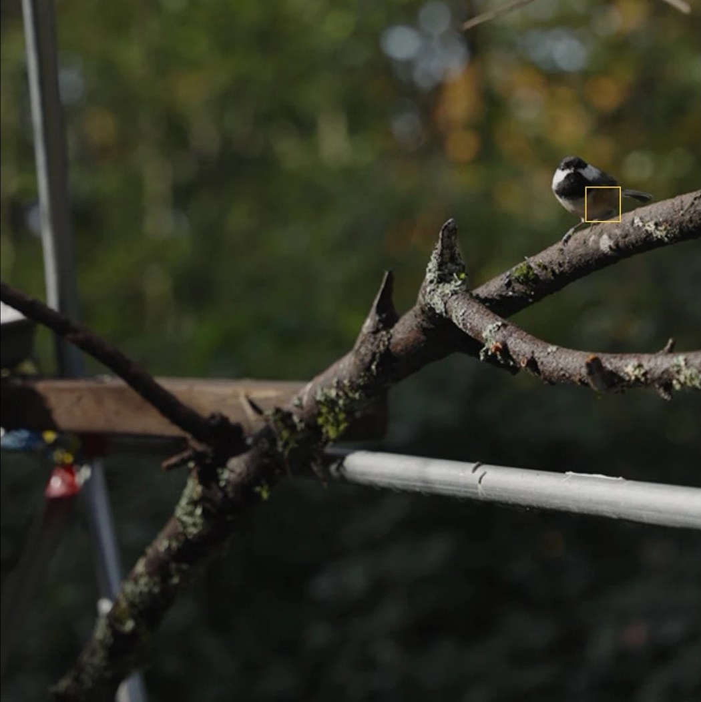
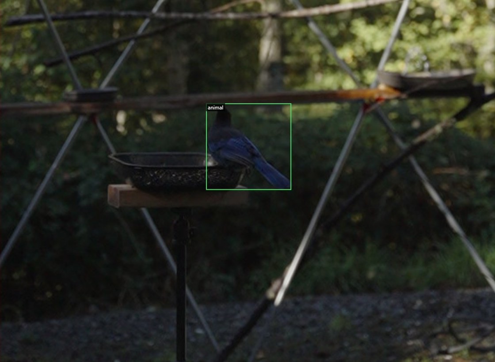
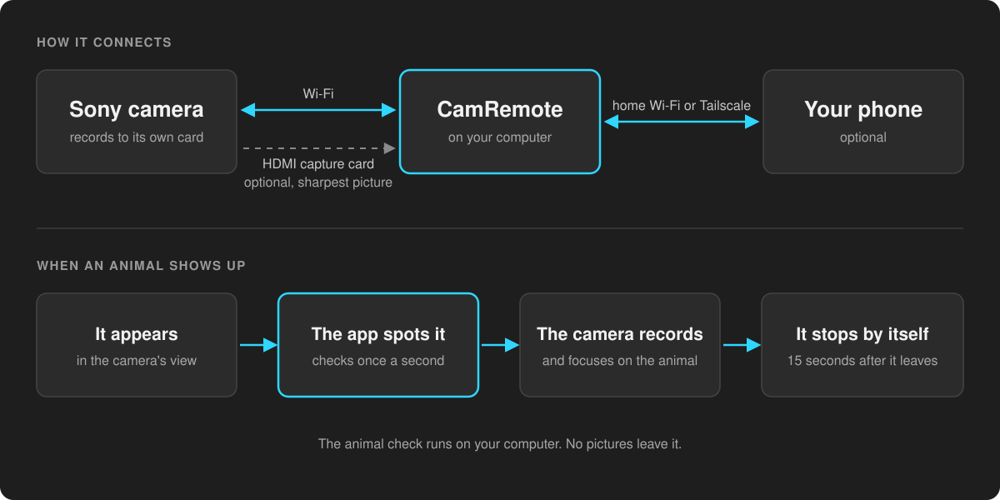

<div align="center">


# CamRemote

**The best way to run a Sony camera from your computer.**<br>
Live picture, focus, exposure, video and photos, all in one window, with no cables.<br>
It can even start filming by itself when an animal shows up.

<br>

<a href="https://github.com/RemingtonWilcox/CamRemote/releases/latest/download/CamRemote-Windows-Setup.exe"></a>
&nbsp;
<a href="https://github.com/RemingtonWilcox/CamRemote/releases/latest/download/CamRemote-Mac-AppleSilicon.dmg"></a>

<sub>Free. No account. No subscription. <a href="https://github.com/RemingtonWilcox/CamRemote/releases/latest/download/CamRemote-Mac-Intel.dmg">Older Intel Mac? Use this one.</a></sub>

<br><br>



</div>

<br>

## Why CamRemote

<table>
<tr>
<td width="50%" valign="top">

</td>
<td width="50%" valign="top">

### It films wildlife for you

Tick one box and walk away. The app watches the picture, starts recording when an animal shows up, focuses on it, and stops 15 seconds after it leaves.

This jay landed on the feeder. The app spotted it, rolled, and put a green box around it.

</td>
</tr>
</table>

### Everything is one click away

**Video** and **Photo** tabs switch the camera for you and keep what you change while shooting right in front of you. Anything you only set once lives in **Setup**, out of the way.

<p align="center">

</p>

<table>
<tr>
<td width="33%" valign="top">

### Real tools

Histogram, zebras, peaking, the camera's meter, a focus ring, a focus magnifier, and one-click base ISO on the A7S III.

</td>
<td width="33%" valign="top">

### Put it anywhere

Hide the camera by a feeder, up a tree or across the yard. If Wi-Fi drops, it keeps recording and the app reconnects by itself.

</td>
<td width="33%" valign="top">

### It's yours

Free and open source. No account, no subscription, no tracking.

</td>
</tr>
</table>

<br>

## Which cameras work?

CamRemote is tested on the **A7S III**. Sony says its remote software can control the cameras below over Wi-Fi, so they should work too, but nobody has tried them yet.

| | |
|---|---|
| **Alpha full frame** | A1 II · A1 · A9 III · A7R VI · A7R V · A7CR · **A7S III (tested)** · A7 V · A7 IV · A7C II |
| **Alpha APS-C** | a6700 |
| **Cinema Line** | FX6 (firmware 3.00 or later) · FX3 (firmware 2.00 or later) · FX3A · FX2 · FX30 · BURANO |
| **Vlogging** | ZV-E1 · ZV-E10 II |
| **Camcorders** | PXW-Z300 · PXW-Z200 · HXR-NX800 |
| **Other** | RX1R III · ILX-LR1 |

Update your camera to its latest firmware first. Some features, such as click to focus, may behave differently on your camera.

**A9 II:** Sony doesn't list it for Wi-Fi, but a user has it connected, with click to focus working. On the camera, turn **Ctrl w/ Smartphone** off, join your Wi-Fi under **Wi-Fi Settings › Access Point Set.**, then under **PC Remote Function** turn **PC Remote** on, set **PC Remote Cnct Method** to **Wi-Fi Access Point**, and choose **Pairing** while CamRemote is searching. To click to focus, set **Focus area** to a **Flexible Spot**. Time-lapse and card formatting don't work on it.

**Won't work over Wi-Fi:** A7R IV, A7R IVA, A7C, RX0 II, BRC-AM7 and FR7. Cameras not listed at all, such as the A7 III or a6400, aren't supported by Sony's software.

<br>

## How it works

<p align="center">

</p>

<br>

## Everything it does

| | |
|---|---|
| **See** | Live view over Wi-Fi, or full quality through an HDMI capture card. Rotate it for a camera on its side |
| **Focus** | Click the picture to focus or track, in MF or DMF drag the focus ring or jump along the focus bar. Focus boxes show what the camera is doing |
| **Check focus** | Focus magnifier and peaking |
| **Expose** | ISO, shutter and iris, with a histogram, zebras and the camera's meter |
| **Record** | One big button, with a red outline around the picture while rolling |
| **Shoot photos** | Single shots, bursts and time-lapses, saved to your card, your computer or both |
| **Film wildlife** | **Record when an animal shows up** does the rest |
| **Set up the camera** | Video format, frame rate, S&Q slow motion, RAW or JPEG, white balance, audio and more, without touching a menu |
| **Save your setups** | **C1** to **C4**, four for video and four for photos, each back with one click |
| **Format a card** | Click **▾** next to the card readout. It asks first |
| **Use your phone** | Tick **Allow phone control** in **Setup**, then open the address it shows |
| **Stay informed** | Battery and card warnings before you run out |
| **Stop worrying** | Reconnects by itself, and the camera keeps recording if Wi-Fi drops |

**Handy keys:** **H** histogram · **Z** zebras · **P** peaking · **G** grid · **F9** record or take a photo (on a Mac, you may need to hold **fn**)

<br>

## Set it up in 3 steps

Allow about 10 minutes. You only do this once.

| | | |
|---|---|---|
| **1** | **[Install the app](#1-install-the-app)** | 2 minutes |
| **2** | **[Set up your camera](#2-set-up-your-camera)** | 5 minutes |
| **3** | **[Connect](#3-connect)** | 1 minute |

> [!TIP]
> **Have an AI assistant?** It can walk you through all of this. [Here's what to paste](#let-your-ai-do-it).

**You'll need:** [a supported camera](#which-cameras-work), Wi-Fi at the place you're shooting, and a Windows 11 PC or a Mac on macOS 14.1 or newer.

<br>

## 1. Install the app

<details open>
<summary><b>On Windows</b></summary>

<br>

1. Open **CamRemote-Windows-Setup.exe** from your downloads.
2. If a blue **Windows protected your PC** box appears, click **More info**, then **Run anyway**. It shows up because the app is new and free, not because anything is wrong.
3. CamRemote installs itself and puts an icon on your desktop.

</details>

<details open>
<summary><b>On a Mac</b></summary>

<br>

1. Open **CamRemote-Mac** from your downloads.
2. Drag **CamRemote** onto the **Applications** folder.
3. Open CamRemote from Applications. If your Mac asks whether you're sure, click **Open**.

Not sure which Mac you have? Click the Apple menu at the top left, then **About This Mac**. If it says **Chip: Apple**, use the main download. If it says **Processor: Intel**, use the Intel one.

</details>

The first time it opens, you'll see a short note about Sony's terms. Click **OK** or **I agree** to continue.

<br>

## 2. Set up your camera

Close Sony's **Monitor & Control** app first. The camera only talks to one remote at a time.

These are the A7S III's menus. Most newer Sony cameras are very similar. If yours look different, search your camera's Help Guide for the name in bold.

On the camera, press **MENU**, then:

| Do this | Where to find it |
|---|---|
| **Join your Wi-Fi.** Pick your network and type its password. | Network › Wi-Fi › Wi-Fi Connect › **On**, then **Access Point Set.** |
| **Allow remote control.** | Network › Cnct./Remote Sht. › Remote Shoot Function › Remote Shooting › **On** |
| **Find your login.** Leave **Access Authen.** on. Then take a photo of the **user** and **password** on **Access Authen. Info**. You'll need them in a minute. | Network › Network Option › Access Authen. Settings |
| **Turn on touch.** This lets you click the picture to focus. | Touch Operation › **On** |
| **Keep it awake.** Otherwise the camera sleeps after a minute and the app can't find it. | Setup › Power Setting Option › Power Save Start Time › **30 Min.** |

> [!NOTE]
> Menu names can differ on older firmware. If yours don't match, update the camera first, using the firmware from your country's Sony support site. CamRemote was tested on the A7S III with firmware 5.01.

<br>

## 3. Connect

1. Make sure your computer and camera are on the **same Wi-Fi**.
2. Open CamRemote and click **Connect camera…**
3. Click your camera in the list.
4. Type the **user** and **password** from your photo.
5. Click **Connect**.

If your computer asks about network access, say yes:

- **Windows:** tick **Private networks** and click **Allow**.
- **Mac:** click **Allow** when it asks about your **local network**. Without this, the app can't find the camera.

**That's it.** Your picture appears, and from now on CamRemote reconnects by itself whenever you open it.

<br>

## On your iPhone

There's also an iPhone app that runs the camera with no computer at all, just your phone's hotspot. It has the live picture, tap to focus, exposure, video, S&Q, photos, burst, time-lapse and C1 to C3 saved setups. Photos and video stay on the camera's card. Close CamRemote on your computer first: the camera only takes one remote at a time.

It can also record when an animal shows up, with the same rules as on a computer: turn on **Record when an animal shows up** on the Video page. **It only works while CamRemote is open on the phone's screen.** iPhones stop apps that aren't on screen, so if you lock the phone or switch apps, it stops watching (and stops a take it started). While the option is on, the app keeps the screen awake, so keep the phone plugged in: a screen that's on for hours, the hotspot and the detector all use battery. The first time you turn it on, the detector takes up to a minute to get ready.

**Control it from a computer through the phone.** Leave the camera outside on your phone's hotspot and run it from a computer somewhere else. Both need [Tailscale](https://tailscale.com) signed in to the same account. In the iPhone app, open **Setup** and turn on **Allow control from a computer**. Then, on the computer, open the Tailscale address it shows and type the access code. You get the same page as phone control on a computer: live picture, record, tap to focus, the focus ring and camera settings.

- **It only works while CamRemote stays open on the iPhone's screen.** iOS pauses apps in the background, so locking the phone or switching apps cuts the computer off until you come back. While the switch is on, the screen stays on, so keep the phone plugged in.
- **It uses mobile data.** The computer gets a smaller picture than the phone shows: 640 pixels wide, and 1, 3 or 8 pictures a second, which you pick in Setup. That's about 100, 280 or 750 MB an hour while a computer is watching, and nothing while none is. Setup shows how much it has really sent.
- **The access code** stays hidden until you tap **Show code**. **New code** signs out every computer that used the old one. Only Tailscale and local network addresses are answered.

**You can't download it yet.** It's still being tested, and it'll come to TestFlight, Apple's beta testing app, first. If you have a Mac and a paid Apple developer account, you can [build it yourself](#build-the-iphone-app).

<br>

## Let your AI do it

Using ChatGPT, Claude or another assistant? Paste this in, and it'll guide you one step at a time, from the camera menus to your first connection:

```text
Help me set up CamRemote for my Sony camera, one step at a time.
Read the guide at https://github.com/RemingtonWilcox/CamRemote/blob/main/AGENTS.md
Ask which camera I have and whether I'm on Windows or Mac, then walk me through it in plain language.
Don't ask me for my camera password.
```

<br>

## Something not working?

<details>
<summary><b>My camera isn't in the list</b></summary>

<br>

Check that the camera is on, on the same Wi-Fi as your computer (not a guest network), and has **Remote Shooting** on. If it still doesn't appear, find its address under Network › Wi-Fi › **Display Wi-Fi Info.**, type that **IP address** into the box in CamRemote and pick your camera underneath.

On a Mac, also check System Settings › Privacy & Security › **Local Network**, and turn CamRemote on.

</details>

<details>
<summary><b>It says the user or password is wrong</b></summary>

<br>

Use the exact **user** and **password** from **Access Authen. Info**. Capitals matter, and the user often isn't `admin`.

</details>

<details>
<summary><b>It won't connect while Monitor & Control is open</b></summary>

<br>

Close Sony's phone app. The camera only takes one remote at a time.

The same goes for CamRemote itself: the computer and the iPhone app can't both be connected. Each keeps trying while it's open, so if the phone lets go (the screen locks, or you switch apps), the computer takes the camera back. Close CamRemote on the computer before you use the phone.

</details>

<details>
<summary><b>The picture is choppy or keeps dropping</b></summary>

<br>

The camera's Wi-Fi signal is weak. Move your router or a mesh point closer to the camera. Recording carries on in the camera even if the link drops.

</details>

<details>
<summary><b>Clicking the picture doesn't focus</b></summary>

<br>

Check that **Tap does** isn't set to **Off**, and that **Touch operation** is on in **Setup**.

If there's no **Touch operation** in **Setup**, the camera doesn't let the app change it, so make sure **Touch Operation** is on in the camera's own menu.

On the A9 II, set **Focus area** to a **Flexible Spot**. A click then moves the spot there and focuses.

</details>

<details>
<summary><b>The camera dials stopped working</b></summary>

<br>

While connected, CamRemote is in charge of the settings. The dials go back to normal when you disconnect.

</details>

<details>
<summary><b>It says the camera's fingerprint changed</b></summary>

<br>

That's normal after resetting the camera or changing its Access Authen. settings. If you did neither, choose **Don't connect**.

</details>

<br>

## Good to know

- **Only tested on the A7S III.** The other cameras on the list should work, but nobody has tried them yet.
- **Warranty:** Sony's terms say a camera controlled through an app like this is no longer covered by its manufacturer warranty.
- **CamRemote isn't made by, endorsed by or supported by Sony.**

<br>

## Specifications

| | |
|---|---|
| **Computer** | Windows 11 x64, or macOS 14.1 or newer on Apple or Intel. Windows on ARM and Linux aren't supported |
| **Connection** | Wi-Fi on the same network as the camera, with an optional HDMI capture card for the picture |
| **Wi-Fi live view** | 1024×576 at around 20 frames a second on the A7S III |
| **Photos to your computer** | Full size, or a small JPEG. A full-size RAW took 4 to 12 seconds on the A7S III in our tests, depending on your network |
| **Time-lapse** | One photo every 1 to 60 seconds, up to 9,999 photos, using the camera's own interval shooting |
| **Animal detection** | Runs on your computer once a second. It knows birds and common mammals, and no pictures leave your computer |
| **Phone control** | A web page on your phone, over your home network or Tailscale, protected by an access code. The computer stays on with the app open |
| **Your camera password** | Stays on your computer, in Windows Credential Manager or your Mac's Keychain |
| **Built on** | Sony's Camera Remote SDK v2.02.00 |
| **Price** | Free. The code is MIT licensed |

<br>

## Other cameras

**More Sony cameras.** The A7R IV, A7R IVA, A7C, RX0 II, BRC-AM7 and FR7 are in Sony's software but can't be reached over Wi-Fi. (The A9 II can, [as above](#which-cameras-work).) A wired connection could bring some of them in. It hasn't been built yet.

**Other brands.** CamRemote only speaks to Sony cameras today. Other makers publish their own developer kits, so the same idea could work there, but each brand would need its own connection built and tested from scratch:

| | |
|---|---|
| **Canon** | [EDSDK and CCAPI](https://www.canon-europe.com/pro/stories/eos-digital-sdk-explained/). CCAPI works over Wi-Fi on supported EOS cameras |
| **Fujifilm** | [X and GFX camera control SDK](https://www.fujifilm-x.com/en-sg/?p=118519), over USB or Wi-Fi |
| **Nikon** | A developer SDK, by sign-up, with support varying by model |

If you'd use one of these, [open an issue](https://github.com/RemingtonWilcox/CamRemote/issues) and say which camera you have.

<br>

---

<details>
<summary><b>More details and tips</b></summary>

<br>

- **Video, Photo and Setup:** the **Video** and **Photo** tabs switch the camera's mode and hold what you change while shooting. **Setup** holds what you set once or now and then, and shows the photo or video settings to match the camera.
- **ISO / Shutter / Iris:** ◀ ▶ step through values. Click the value to see every choice.
- **Base ISO 640 / 12800:** the A7S III's two native ISOs in S-Log3. 12800 is the cleanest choice in low light. These buttons only appear on the A7S III. On other cameras, use the ISO control.
- **Focus wheel:** works in MF (or DMF). Right is farther, left is nearer. Drag slowly for fine focus and faster for bigger moves.
- **Focus bar:** shows where focus sits between close up and infinity, if your camera and lens report it. Click it to jump there, or hold the flower or mountain button to keep moving.
- **Focus boxes:** the boxes on the picture are the ones the camera reports: green means in focus, and thicker boxes are tracking or a face. The outline of a large focus area isn't drawn. A small circle only shows where you clicked.
- **Focus magnifier:** the A7S III won't magnify over Wi-Fi in movie mode, so the ×2 and ×4 buttons enlarge the preview in the app instead. Click the picture to move around. It's the same preview pixels, so a Wi-Fi picture gets soft; a capture card shows more detail. If your camera does allow it, the buttons use the camera's own magnifier.
- **Click the picture:** works on the Video and Photo tabs. Right-click cancels a touch focus or tracking if the camera is holding one (Control-click on a Mac). In MF it autofocuses once, then returns to MF.
- **Tap does:** Focus, Tracking or Off. Off stops clicks doing anything. Sony's SDK doesn't offer the setting for a remote tap's function on the A7S III, so Tracking may only focus. The app tells you if the camera didn't start tracking.
- **Picture source:** in **Setup**. **Camera over Wi-Fi** needs no cable. Any HDMI capture card your computer sees is listed too. Plugged one in after opening the app? Click **↻**. Set the camera's **HDMI Resolution** to **1080p** and turn **HDMI Info. Display** off. On a Mac, the app asks for Camera and Microphone access the first time you pick one.
- **Format a card:** click **▾** next to the card readout. It works while the camera isn't recording, erases the whole card, and asks first. The app can't tell whether you've copied your footage off, so check that yourself.
- **Rotate:** ⟲ / ⟳ in **Setup**, for a camera mounted in portrait.
- **Burst:** set **Drive** to a burst speed, then hold **Take photo** down.
- **C1 to C4:** click an empty one to save how the camera is set now: mode, exposure, focus, and for video the format and frame rate. Click it again later to put all of that back. The Video and Photo tabs each have their own four. A preset turns green while the camera matches it. Right-click to save over it or clear it (Control-click on a Mac). If the camera's mode dial is somewhere a preset can't reach, the app says so.
- **S&Q (slow and quick motion):** under **Recording** on the Video tab, switch between **Normal** and **S&Q**. In S&Q, **S&Q shoots at** is how many frames a second the camera captures, and **S&Q plays at** is the speed it's played back at, so 240fps played at 24p is ten times slower. The fastest rates need an HD file format. Save one to a preset, like 1080p at 240fps on C1, to get to it in one click.
- **Time-lapse:** open **Time-lapse** under **Drive** and turn it on. The big button then says **Start time-lapse**, and **Stop time-lapse** once it's running.
- **Photos on your computer:** choose **Computer**, **Card** or **Both** under **Saving** in **Setup**. They go to `Pictures/CamRemote` until you click **Change folder**. A full-size RAW can take 4 to 12 seconds to arrive, so for bursts and time-lapses use **Both** with **Small JPEG**: the card keeps the full files.
- **Record when an animal shows up:** runs on your computer, and no pictures leave it. It knows birds and a few other animals (cats, dogs, horses, sheep, cows, elephants, bears, zebras and giraffes), and something it doesn't know, like a squirrel, may not set it off. A green box follows the animal while the option is on. Set **Rotate** to match how the camera is mounted first: it sees far better the right way up. Takes stop at 5 minutes and start again if the animal is still there. If it keeps being set off by something that isn't an animal, like splashing water, it learns to ignore that spot for 10 minutes. It only stops takes it started itself.
- **Updates:** when the app opens, it asks GitHub once for the latest version number. If there's a newer one, a green button appears at the bottom of the window. It opens the download page and installs nothing by itself.
- **Shooting guides:** worked out from the preview, not the recorded file, so a Monitor LUT changes them. At Wi-Fi preview size, peaking shows the plane of focus. Use the magnifier for critical focus.
- **Recording timer:** keeps counting through a dropped link or an app restart. A take already rolling when the app first sees it shows a **+**.
- **Phone control:** works on your home network and over Tailscale, and needs the access code. The app hides it until you click **Show code**, and **New code** replaces it and signs phones out. The computer must stay on with the app open. On an iPhone, use Share › Add to Home Screen for a full-screen app.
- **Audio:** live meters need HDMI through a capture card, because the camera sends no sound over Wi-Fi. Aim for loud sounds peaking around −12 dB and never reaching 0.
- **Keeping the same address:** reserve the camera's IP address in your router so it never changes. The app usually finds the camera again anyway.

</details>

<details>
<summary><b>Build it yourself (for developers)</b></summary>

<br>

You'll need Sony's Camera Remote SDK from [their site](https://support.d-imaging.sony.co.jp/app/sdk/en/index.html). Unzip the version for your system into `vendor/CrSDK` so `vendor/CrSDK/RemoteCli.zip` exists. Never commit anything under `vendor/`.

The animal detector needs one more file, which the app can be built without (the option just won't appear). Save it as `vendor/BirdModel/rfdetr_nano_fp16.onnx`:

```bash
curl -L --create-dirs -o vendor/BirdModel/rfdetr_nano_fp16.onnx https://huggingface.co/onnx-community/rfdetr_nano-ONNX/resolve/main/onnx/model_fp16.onnx
```

The iPhone app uses the full-size version of the same model instead, because Core ML can't run the half-size one. It adds about 110 MB to the app:

```bash
curl -L --create-dirs -o vendor/BirdModel/rfdetr_nano.onnx https://huggingface.co/onnx-community/rfdetr_nano-ONNX/resolve/main/onnx/model.onnx
```

**Windows:** install Git, CMake, the .NET 10 SDK, Python and Visual Studio's C++ tools, then:

```powershell
powershell -ExecutionPolicy Bypass -File .\build.ps1
```

**Mac:** install Xcode's command line tools, then CMake, Python and the .NET 10 SDK, then:

```bash
./build-mac.sh
```

<a id="build-the-iphone-app"></a>**iPhone:** it doesn't use Sony's SDK. The only thing it takes from `vendor/` is the animal detector's `rfdetr_nano.onnx`, and it builds without it. On a Mac with Xcode, install CMake and XcodeGen, then:

```bash
cd app/CamRemote.iOS
./build-deps.sh
DEVELOPMENT_TEAM=<your team id> ./build-iphone.sh
```

Run these in Terminal on the Mac itself, so signing can reach your Keychain. Then install the app on your phone from Xcode's **Devices** window.

**Making the downloads:** `package-windows.ps1` builds the installer with Inno Setup. `package-mac.sh` builds both notarized disk images, and its comments explain the one-time setup. Upload those files and `libusb-source.zip` to a GitHub release.

**How it's put together:**

- `native/CamBridge/`: a small C++ library that wraps Sony's SDK in a flat C API returning JSON. `MacSupport.mm` adds the Mac's Keychain, keep-awake, capture and audio code.
- `app/CamRemote/`: the Windows app (WPF, .NET 10) and the camera code both apps share.
- `app/CamRemote.Mac/`: the Mac app (Avalonia, .NET 10). A change to a window or control usually needs making in both.
- `app/CamRemote.iOS/`: the iPhone app (SwiftUI). It talks to the camera directly over SSH and PTP/IP, and shares no code with the others. `AnimalTrigger.swift` follows the same rules as `BirdTrigger.cs`, so a change to one usually needs making in both.
- `tools/`: generates names from the SDK headers, draws the icon, writes the notices and holds the packaging settings.

Notes from Sony's SDK reference (v2.02.00) for the A7S III:

- Remote touch focus acts by itself in movie mode only. In photo mode the app half-presses the shutter to make the camera focus. Focus positions are a 640×480 grid over the picture.
- MovieRecord "Down" toggles recording; Sony asks for "Up" right after it.
- Over Wi-Fi the camera reports battery in bars, not percent, so the app shows a range.
- There's no live audio level over the SDK.

</details>

<details>
<summary><b>Licence</b></summary>

<br>

CamRemote's code is MIT licensed (see `LICENSE`). The downloads for Windows and Mac include Sony's Camera Remote SDK libraries under [Sony's licence](https://support.d-imaging.sony.co.jp/app/sdk/licenseagreement/en-US.html), plus open-source parts listed in `NOTICES.md`. The SDK isn't in this repository, and the iPhone app doesn't use it.

</details>
